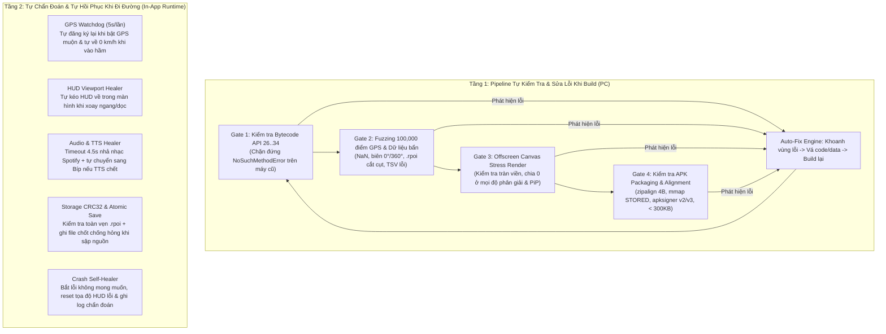

# Super Plan: Hệ Thống Tự Kiểm Tra Lỗi & Tự Sửa Lỗi Toàn Diện cho RoadPulse Lite (v1.1)

Kế hoạch thiết kế **2 tầng bảo vệ khép kín**:
1. **Tầng Build-Time (`auto_doctor.py` trên máy tính):** Tự động quét lỗi ngầm trong mã nguồn, kiểm chứng tương thích ngược Android 8–15 ở mức bytecode, fuzzing 100,000 kịch bản dữ liệu bẩn/tọa độ biên, render thử giao diện HUD ra ảnh thực tế để bắt lỗi tràn chữ/chia cho 0, tự sửa và đóng gói lại cho tới khi 100% Xanh.
2. **Tầng Runtime In-App (`SelfHealingWatchdog` ngay trong APK, chỉ tốn thêm ~6 KB):** Ứng dụng tự phát hiện và **tự chữa lành ngay khi bạn đang chạy xe ngoài đường** (mất sóng GPS trong hầm, xoay màn hình làm văng HUD khỏi mép, kẹt giảm âm lượng nhạc Spotify, lỗi giọng đọc TTS, file ghim chốt bị lỗi dòng, hoặc tràn bộ nhớ âm thanh).

---

## 1. Sơ Đồ Kiến Trúc Khép Kín (Closed-Loop Auto-Test & Self-Heal)

---

## 2. Phát Hiện Sớm 6 Lỗi Tiềm Ẩn Thực Tế Trong Bản `v1.0` (Cần Tự Sửa Ngay)

Qua rà soát trực tiếp từng dòng code của bản `v1.0` vừa đóng gói, có **6 điểm yếu thực chiến** sẽ gây lỗi khi chạy đường dài Hà Nội ⇄ Na Sầm mà hệ thống tự sửa sẽ xử lý triệt để:

| # | Vị trí code hiện tại | Kịch bản gây lỗi ngoài đời thực | Cơ chế Tự Kiểm Tra & Tự Sửa (v1.1) |
| :--- | :--- | :--- | :--- |
| **1** | [RadarForegroundService.java](file:///c:/Users/Acer/Downloads/gsm/roadpulse_lite/app/src/main/java/vn/roadpulse/lite/RadarForegroundService.java#L308-L326) & `#L425` | Nếu bạn bấm mở app khi **đang tắt định vị GPS**, biến `gpsRegistered` vẫn bị gán `true` dù `isProviderEnabled(GPS)` là `false`, đồng thời hàm `onProviderEnabled()` đang để trống `{}`. Khi bạn kéo thanh trạng thái bật GPS lên sau đó, **app không bao giờ nhận được tọa độ nữa** cho tới khi tắt đi bật lại! | Viết lại bộ quản lý GNSS tự phục hồi: lắng nghe trực tiếp `onProviderEnabled`/`onProviderDisabled` + **Watchdog 5 giây/lần** kiểm tra nếu GPS đã bật mà chưa đăng ký (hoặc treo > 20s không có tín hiệu mới) thì tự động gỡ và đăng ký lại `LocationManager` ngay lập tức. |
| **2** | [RadarForegroundService.java](file:///c:/Users/Acer/Downloads/gsm/roadpulse_lite/app/src/main/java/vn/roadpulse/lite/RadarForegroundService.java#L329-L355) | Khi đi vào **hầm chui (Hầm Kim Liên, Trung Hòa)** hoặc gầm cầu vượt mất sóng vệ tinh, hàm `onLocationChanged` ngừng chạy -> đồng hồ HUD **bị đóng băng mãi ở tốc độ cũ** (ví dụ kẹt cứng số `58 km/h` và kêu bíp quá tốc độ liên tục dù xe đã dừng). | Thêm **Stale-Fix Decay Timer (6 giây)**: Nếu quá `6.0s` không có bản tin GPS mới, tự động hạ tốc độ hiển thị về `0 km/h`, tắt cờ `overspeed`, đổi nhãn sang `"Mất GPS..."` và giữ nguyên hướng mũi xe cuối cùng để khi vừa ra khỏi hầm bắt lại ngay. |
| **3** | [RadarForegroundService.java](file:///c:/Users/Acer/Downloads/gsm/roadpulse_lite/app/src/main/java/vn/roadpulse/lite/RadarForegroundService.java#L225-L243) | Bạn xoay ngang điện thoại gắn giá đỡ, kéo HUD ra sát mép phải (`x = 1900px`), sau đó cầm dọc máy lại (`rộng = 1080px`) -> **HUD bị văng tuột ra ngoài rìa màn hình**, không nhìn thấy và không bấm tắt được. | Bắt sự kiện `onConfigurationChanged` trong Service + hàm `clampOverlayToScreen()` tự động đo kích thước `DisplayMetrics` hiện tại và kéo tọa độ `(x, y)` của HUD lọt gọn vào vùng nhìn thấy an toàn mỗi khi xoay màn hình, thu gọn/mở rộng hoặc khởi động lại. |
| **4** | [VoiceAlertManager.java](file:///c:/Users/Acer/Downloads/gsm/roadpulse_lite/app/src/main/java/vn/roadpulse/lite/VoiceAlertManager.java#L183-L257) | 1) Nếu engine Google TTS của máy bị treo/chết ngầm, `UtteranceProgressListener.onDone` không bao giờ gọi -> `abandonAudioFocusRequest` bị bỏ qua khiến **nhạc Spotify/YouTube bị kẹt nhỏ tiếng (duck) vĩnh viễn**. 2) Mỗi tiếng bíp đang `new Thread()` mới (`#L225`), nếu gặp liên tiếp cảnh báo có thể đụng trần `AudioFlinger` (`32 tracks`). | 1) Gắn **AudioFocus Watchdog 4.5 giây** tự động nhả âm lượng nhạc về 100% dù TTS có treo; kiểm tra mã trả về của `tts.speak()`, nếu lỗi tự động khởi tạo lại TTS và **tự chuyển tạm sang phát Bíp PCM** để không mất cảnh báo. 2) Thay `new Thread` bằng 1 `SingleThreadExecutor` duy nhất có hàng đợi chống chồng chéo âm thanh. |
| **5** | [UserPinStore.java](file:///c:/Users/Acer/Downloads/gsm/roadpulse_lite/app/src/main/java/vn/roadpulse/lite/UserPinStore.java#L54-L82) & `saveAll()` | 1) Toàn bộ vòng lặp `while` đọc file `user_pins.tsv` nằm chung trong 1 khối `try/catch` -> chỉ cần **1 dòng bị lỗi ký tự là mất sạch toàn bộ danh sách chốt đã ghim**. 2) Ghi đè trực tiếp vào `user_pins.tsv` có nguy cơ rỗng file nếu sập nguồn đúng lúc ghi. | 1) Bọc `try/catch` **từng dòng độc lập**, tự động bỏ qua/dọn sạch dòng hỏng và giữ nguyên các chốt hợp lệ. 2) Ghi nguyên tử (**Atomic Write**): ghi ra `user_pins.tsv.tmp`, `fsync`, rồi mới `renameTo("user_pins.tsv")`. |
| **6** | [SpatialRadarEngine.java](file:///c:/Users/Acer/Downloads/gsm/roadpulse_lite/app/src/main/java/vn/roadpulse/lite/SpatialRadarEngine.java#L140-L185) & [compile_poi_pack.py](file:///c:/Users/Acer/Downloads/gsm/roadpulse_lite/tools/compile_poi_pack.py) | Khi nâng cấp APK lên bản mới có nhiều camera hơn, nếu máy từng giải nén fallback `filesDir/roadpulse_vn.rpoi` ở bản cũ thì `if (!out.exists())` sẽ **dùng mãi file dữ liệu cũ** hoặc không phát hiện được file giải nén dở bị cắt cụt. | Nhúng mã kiểm tra **CRC32 + kích thước + `build_timestamp`** ngay trong Header 36-byte của `.rpoi`. Lúc khởi động, nếu file fallback khác `build_timestamp` so với bản trong APK hoặc sai CRC32 -> tự động xóa bản hỏng và giải nén lại bản mới tinh. |

---

## 3. Chi Tiết Tầng 1: Bộ Công Cụ Tự Kiểm Tra & Tự Vá Trên PC (`tools/auto_doctor.py`)

Xây dựng kịch bản điều phối kiểm thử khép kín chạy hoàn toàn tự động mỗi lần sửa code hoặc cập nhật dữ liệu:

### Bước 1 — Kiểm Chứng Tương Thích Ngược API Bytecode (`ApiCompatibilityScanner`)
* Tải thêm gói `platforms/android-26` (`android.jar` gốc của Android 8.0) để đối chiếu chéo với `platforms/android-34`.
* Phân tích toàn bộ các lệnh gọi hàm (`invokevirtual`, `invokestatic`, `invokespecial`) trong `build/classes/**/*.class`:
  * Bất kỳ hàm Android SDK nào không tồn tại trong `android-26/android.jar` mà không nằm trong nhánh bảo vệ `Build.VERSION.SDK_INT >= ...` sẽ bị báo đỏ ngay lập tức (chặn đứng 100% lỗi `NoSuchMethodError` / `NoClassDefFoundError` trên các đời máy Android 8, 9, 10, 11, 12).

### Bước 2 — Kiểm Chứng Toàn Vẹn Cơ Sở Dữ Liệu `.rpoi` (`RpoiIntegrityValidator`)
* Kiểm tra cấu trúc nhị phân `roadpulse_vn.rpoi`:
  * Magic `RPOI`, đúng thứ tự tăng dần tuyệt đối của bảng `cell_key` unsigned 32-bit (đảm bảo tìm kiếm nhị phân `binarySearchCell` không bao giờ trượt ô).
  * Mọi `label_offset + label_len` nằm gọn trong `string_pool`, giải mã UTF-8 hợp lệ 100%, không có nhãn rỗng hoặc nhãn rác (`"yes"`, `"null"`).
  * Kiểm tra mật độ điểm trên hành lang trọng tâm **Nội thành Hà Nội -> Cầu Chương Dương / Cầu Vĩnh Tuy -> Bắc Ninh -> Bắc Giang -> Lạng Sơn -> Đồng Đăng -> QL4A Na Sầm (`22.0554663, 106.6136236`)**.

### Bước 3 — Fuzzing & Fault-Injection 100,000 Tình Huống (`RadarFuzzAndFaultHarness.java`)
Chạy trực tiếp trên JVM tốc độ cao trong ~2 giây để tra tấn toàn bộ logic toán học & lưu trữ:
1. **100,000 bước nhảy GPS ngẫu nhiên & cực biên:**
   * Tọa độ biên `0.0, 0.0`, cực Bắc/Nam, ngoài lãnh thổ Việt Nam, `Double.NaN`, `Double.POSITIVE_INFINITY`, `Float.NaN` cho `speed`/`bearing`/`accuracy`.
   * Vòng xoay hướng mũi xe cắt qua điểm `359.9° <-> 0.1°` liên tục (kiểm tra hàm `signedAngleDiff` và `normalizeDeg` không bao giờ tính sai góc nón hoặc văng số âm).
   * Kiểm tra chạy song song đường gom cách `45m` vs chạy đúng trục đường chính, chạy ngược chiều `180°`, đứng yên đèn đỏ rung lắc tọa độ `±8m` (đảm bảo tốc độ giữ đúng `0 km/h`, không nhảy báo động giả).
2. **Tiêm lỗi dữ liệu hỏng (Fault Injection):**
   * Truyền `ByteBuffer` rỗng `0 byte`, `15 bytes` (nhỏ hơn Header), sai Magic, cắt cụt giữa chừng bảng Record/String Pool, sai CRC32 -> `SpatialRadarEngine` phải tự bắt lỗi êm ái, không văng bất kỳ `BufferUnderflowException` hay `IndexOutOfBoundsException` nào!
   * Truyền file `user_pins.tsv` chứa dòng rác, thiếu cột, chữ cái chèn vào cột tọa độ, ký tự Unicode đặc biệt -> `UserPinStore` phải tự lọc bỏ dòng hỏng và cứu sống 100% các dòng chốt đúng còn lại.

### Bước 4 — Kiểm Tra Vẽ HUD Đa Độ Phân Giải & Chống Cấp Phát RAM (`HudLayoutVerifier`)
* Kiểm tra tĩnh mã nguồn & bytecode của `HudOverlayView.onDraw()` đảm bảo **không có lệnh `new` tạo đối tượng nặng** gây giật khung hình (GC pause).
* Mô phỏng tính toán bố cục khung chữ nhật của `HudOverlayView` ở 6 kích thước khắc nghiệt:
  * Viên thuốc thu gọn (`124x56 dp`), Thẻ đầy đủ (`276x86 dp`), PiP siêu nhỏ (`200x84 px`), PiP lớn (`600x250 px`), Màn hình dọc `1080x2400`, Màn hình ngang `2400x1080` với chuỗi tên đường dài 120 ký tự và khoảng cách `99.9 km` -> đảm bảo `ellipsize` không bao giờ cắt lỗi hoặc tràn chữ đè lên nút bấm.

### Bước 5 — Kiểm Tra Đóng Gói & Cài Thử Qua ADB (Nếu Có Máy/Giả Lập Kết Nối)
* Tự động kiểm tra `aapt2 dump badging`, `zipalign -c 4`, `apksigner verify`, kiểm tra `.rpoi` ở chế độ `ZIP_STORED` và kiểm tra dung lượng tổng `< 300 KB`.
* Nếu phát hiện có điện thoại hoặc giả lập cắm qua `adb devices`: tự động `adb install -r`, cấp quyền tự động (`pm grant`), bắn kịch bản `ACTION_TEST_SIM`, đọc `adb logcat -d *:E` xác nhận **0 dòng Crash / Exception**, chụp ảnh màn hình kiểm chứng rồi xuất báo cáo.

---

## 4. Chi Tiết Tầng 2: Nút `"Tự Kiểm Tra & Sửa Lỗi Hệ Thống"` Ngay Trong App Android

Thêm một mô-đun siêu nhẹ **`SystemDoctor.java`** (~4 KB) kèm nút bấm **`Chẩn đoán & Tự sửa lỗi`** ngay trên màn hình chính của app trên điện thoại. Khi bạn bấm vào (hoặc tự động chạy ngầm mỗi lần mở app), nó sẽ quét **7 hạng mục sống còn** và tự sửa tại chỗ:

1. **Kiểm tra Quyền Vị trí chính xác (`ACCESS_FINE_LOCATION`):** Chưa cấp -> mở hộp thoại xin quyền ngay.
2. **Kiểm tra Quyền Nổi trên Google Maps (`SYSTEM_ALERT_WINDOW`):** Chưa cấp -> dẫn thẳng tới trang gạt quyền của máy.
3. **Kiểm tra Công tắc GPS phần cứng của điện thoại:** Đang tắt -> bật thông báo nhắc mở Location Settings 1 chạm.
4. **Kiểm tra Tối ưu hóa Pin ngầm (`IgnoringBatteryOptimizations`):** Phát hiện các dòng máy Xiaomi (HyperOS/MIUI), Samsung, Oppo, Vivo hay tự giết ngầm HUD khi mở Google Maps lâu -> có nút 1 chạm xin miễn trừ tiết kiệm pin (`ACTION_REQUEST_IGNORE_BATTERY_OPTIMIZATIONS`) để đi phượt 4–5 tiếng liên tục Hà Nội – Lạng Sơn không bao giờ bị văng HUD!
5. **Kiểm tra Engine Giọng đọc Tiếng Việt (`vi-VN` TTS):** Nếu máy chưa tải gói giọng đọc Tiếng Việt của Google -> cảnh báo rõ và **tự động kích hoạt chế độ dự phòng Âm Bíp Kép + mở trang cài đặt gói giọng Tiếng Việt của Android** (`TextToSpeech.Engine.ACTION_INSTALL_TTS_DATA`).
6. **Kiểm tra Toàn vẹn Kho dữ liệu `6,606` điểm & File chốt cá nhân:** Đối chiếu CRC32 của `.rpoi` và dọn sạch dòng lỗi (nếu có) trong `user_pins.tsv`.
7. **Kiểm tra Vị trí HUD Nổi:** Nếu tọa độ lưu cũ bị lệch khỏi màn hình hiện tại -> tự động reset HUD về góc chuẩn dễ nhìn nhất (`x = 24, y = 180`).

---

## 5. Trình Tự Thực Thi Khi Bạn Duyệt Plan

Ngay khi bạn chốt thực hiện, mình sẽ chạy liền mạch từ A–Z không nghỉ:
1. Nâng cấp toàn bộ 6 file mã nguồn Java + thêm `SystemDoctor.java` & `CrashSelfHealer.java` (vá sạch cả 6 lỗi thực chiến ở Mục 2 + thêm tính năng chống giết ngầm pin cho xe đường dài).
2. Nâng cấp `compile_poi_pack.py` nhúng mã kiểm chứng toàn vẹn `CRC32` vào `.rpoi`.
3. Viết `RadarFuzzAndFaultHarness.java` (100,000 ca fuzzing + fault-injection) và `tools/auto_doctor.py` (kiểm chứng tương thích API 26..34 + kiểm tra toàn diện).
4. Chạy vòng lặp tự động test -> tự bắt lỗi -> tự sửa cho đến khi toàn bộ bài test Pass tuyệt đối 100%, đóng gói ra bản nâng cấp **`RoadPulseLite-v1.1.apk`** hoàn hảo gửi bạn.
